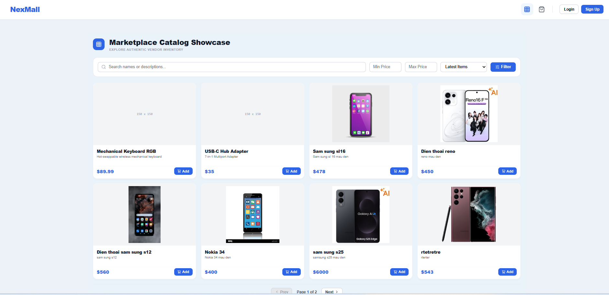
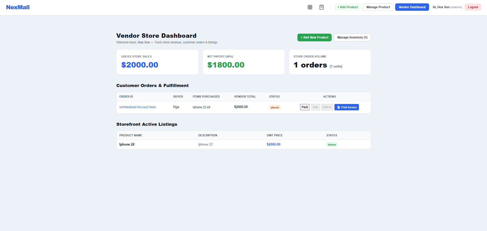
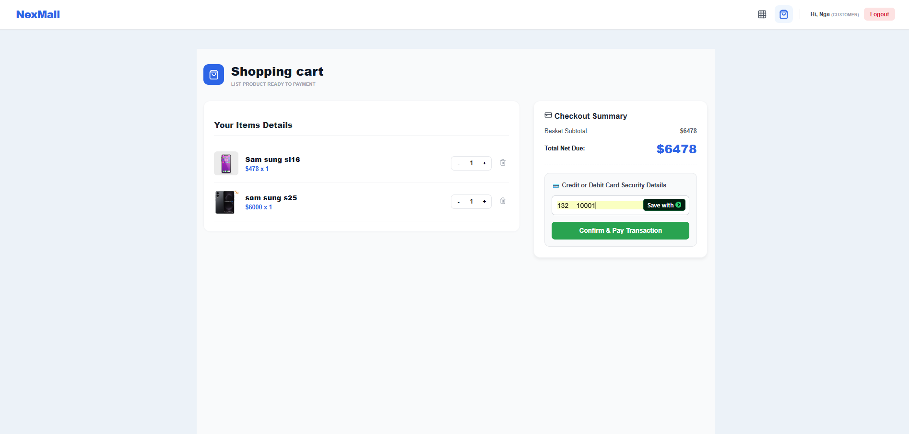
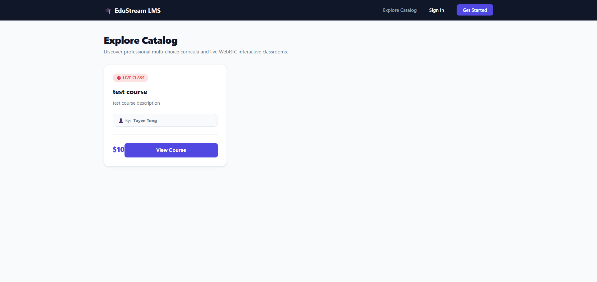
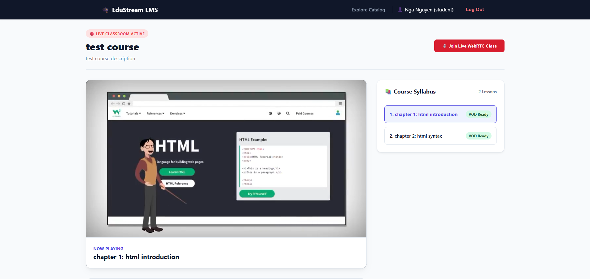
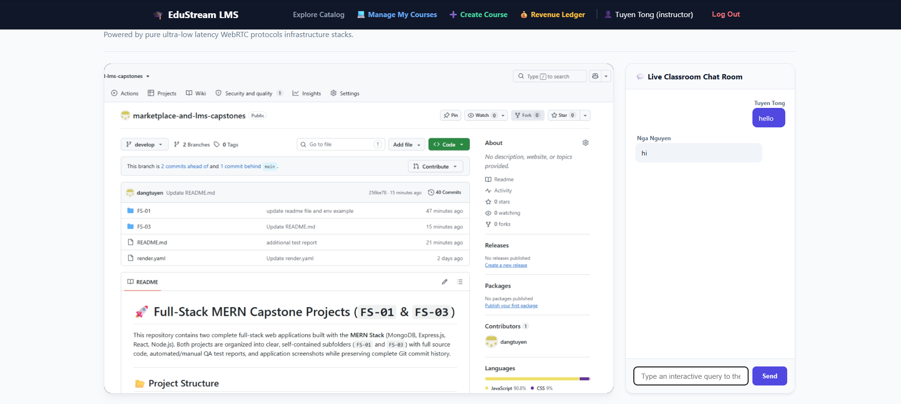
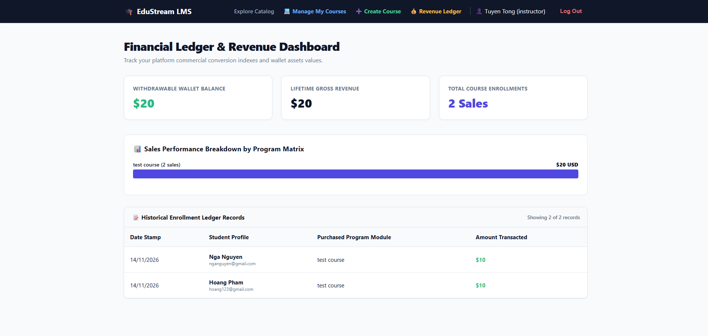

# 🚀 Full-Stack Capstone Portfolio: Multi-Vendor Marketplace & Live LMS

A dual-project full-stack engineering repository featuring two production-grade MERN applications:
1. **`FS-01` — vendorHub (NexMall):** A multi-vendor e-commerce marketplace with Redis session carts, Supabase S3 object storage, Stripe Connect split payments, and a Vendor Store Dashboard.
2. **`FS-03` — EduStream LMS:** A live virtual classroom and adaptive Video-on-Demand (VOD) platform with BullMQ/FFmpeg HLS streaming, LiveKit WebRTC video/chat, auto-graded quizzes, and PDF certificates.

---

## 📂 Repository Overview

```text
marketplace-and-lms-capstones/
├── FS-01/                          # Multi-Vendor E-Commerce Marketplace (vendorHub / NexMall)
│   ├── vendorHubBE/                # Node.js, Express, MongoDB, Redis, Stripe & S3 Backend + Tests
│   ├── vendorHubFE/                # React Frontend (Storefront, Vendor Dashboard, Cart, Admin) + Tests
│   ├── screenshots/                # Verified UI & Workflow Captures
│   └── README.md                   # FS-01 Setup, Architecture & Testing Guide
│
├── FS-03/                          # Live Classroom & Adaptive VOD Platform (EduStream LMS)
│   ├── backend/                    # Node.js, Express, BullMQ, FFmpeg, LiveKit & PDFKit + Tests
│   ├── frontend/                   # React (Vite) Frontend (HLS Player, WebRTC Stage, Quizzes) + Tests
│   ├── screenshots/                # Verified UI & Feature Captures
│   ├── tests/                      # QA & Manual Test Execution Report (.docx)
│   ├── docker-compose.yml          # Containerized MongoDB, Redis & LiveKit Setup
│   └── README.md                   # FS-03 Setup, Architecture & Testing Guide
│
└── README.md                       # Root Repository Documentation (this file)
```

---

## 🧩 Project Comparison & Tech Stack

| Feature Area | `FS-01` — vendorHub (NexMall) | `FS-03` — EduStream LMS |
| :--- | :--- | :--- |
| **Core Domain** | Multi-Vendor E-Commerce Marketplace | Live Virtual Classroom & Adaptive VOD LMS |
| **Frontend** | React 18 (CRA), Axios, Lucide Icons, Custom CSS | React 18 (Vite 5), React Router v6, `hls.js`, `livekit-client` |
| **Backend** | Node.js, Express, Mongoose, JWT | Node.js (ESM), Express, Mongoose, JWT, PDFKit |
| **Database & Cache** | MongoDB Atlas + Redis Cloud (7-Day Session Carts) | MongoDB + Redis (BullMQ Async Video Queue) |
| **Media & Real-Time** | Supabase Object Storage (AWS S3 SDK) | FFmpeg (`.m3u8` / `.ts` HLS) + LiveKit WebRTC SFU |
| **Payments & Ledger** | Stripe Connect Split Payouts & HTML Invoices | Self-Contained Sandbox Gateway + Instructor Revenue Ledger |
| **Automated Tests** | `node:test` + Supertest (BE) / Jest + RTL (FE) | `node:test` + Supertest (BE) / Vitest + RTL (FE) |

---

## ⚡ Quick Start & Automated Testing

### Clone the Repository
```bash
git clone https://github.com/dangtuyen/marketplace-and-lms-capstones.git
cd marketplace-and-lms-capstones
```

### 1. `FS-01` — vendorHub (NexMall)
* **Full Documentation:** [`FS-01/README.md`](./FS-01/README.md)
* **Run Services:**
  ```bash
  # Backend (Port 5000)
  cd FS-01/vendorHubBE && npm install && npm run dev

  # Frontend (Port 3000)
  cd FS-01/vendorHubFE && npm install && npm start
  ```
* **Run Automated Unit & API Tests:**
  ```bash
  # Backend API Tests
  cd FS-01/vendorHubBE && npm test

  # Frontend Component Tests
  cd FS-01/vendorHubFE && npm test
  ```

### 2. `FS-03` — EduStream LMS
* **Full Documentation:** [`FS-03/README.md`](./FS-03/README.md)
* **Run Services:**
  ```bash
  # Start MongoDB, Redis & LiveKit via Docker
  cd FS-03 && docker-compose up -d

  # Backend (Port 5000)
  cd FS-03/backend && npm install && npm run dev

  # Frontend (Port 5173)
  cd FS-03/frontend && npm install && npm run dev
  ```
* **Run Automated Unit & API Tests:**
  ```bash
  # Backend API Tests
  cd FS-03/backend && npm test

  # Frontend Component Tests
  cd FS-03/frontend && npm test
  ```

---

## 📸 Visual Walkthrough

### `FS-01`: vendorHub Marketplace

| Storefront Catalog | Vendor Store Dashboard |
| :---: | :---: |
|  |  |

| Shopping Cart & Stripe Checkout | Admin Revenue & Order Oversight |
| :---: | :---: |
|  |  |

### `FS-03`: EduStream LMS

| Course Catalog | Adaptive HLS Video Player |
| :---: | :---: |
|  |  |

| Live WebRTC Classroom & Chat | Instructor Revenue Ledger |
| :---: | :---: |
|  |  |

---

## 📄 License

This repository is licensed under the [MIT License](LICENSE).
